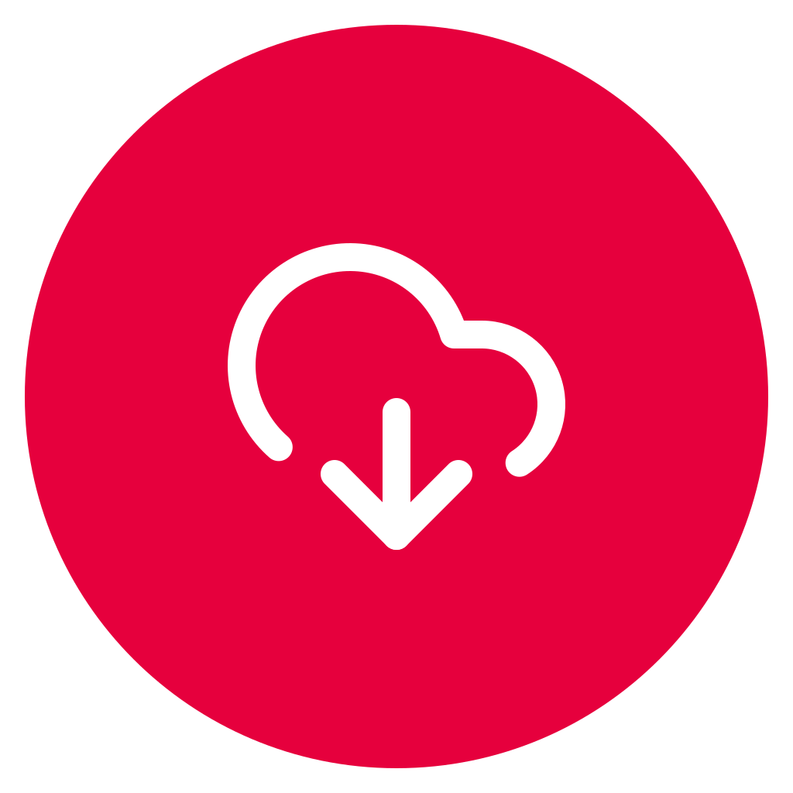
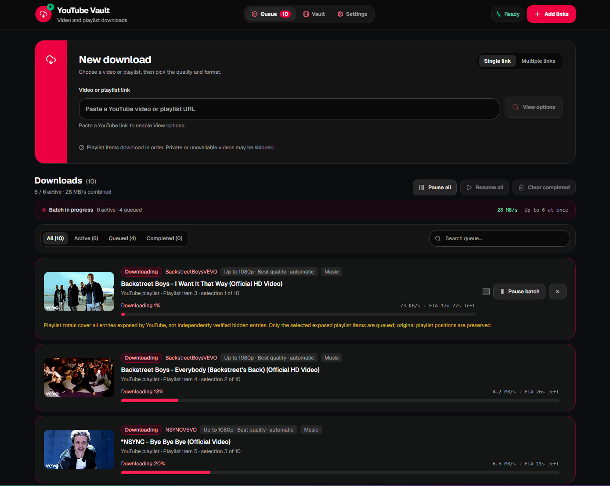
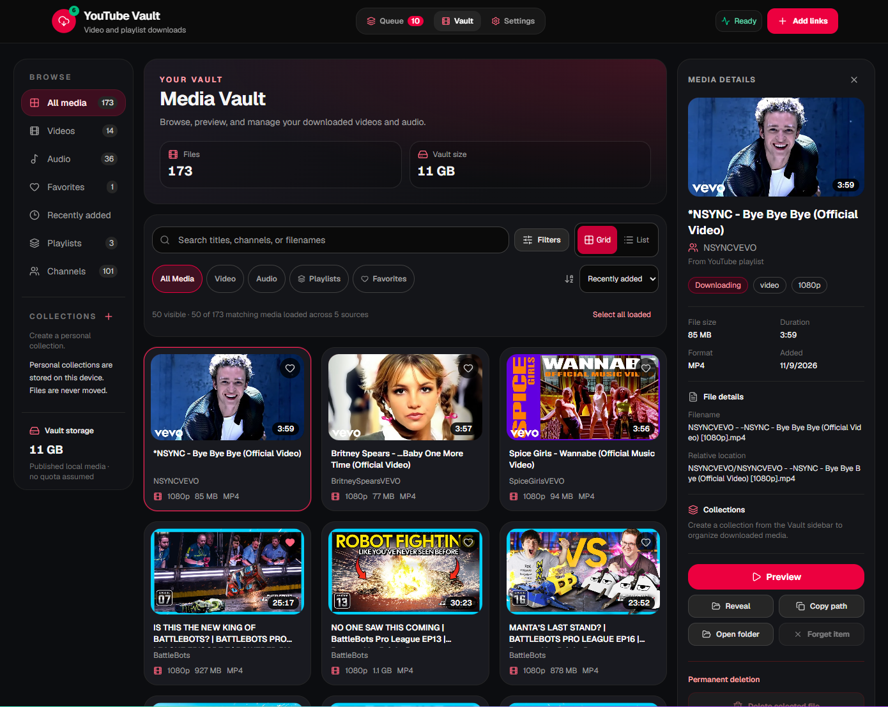
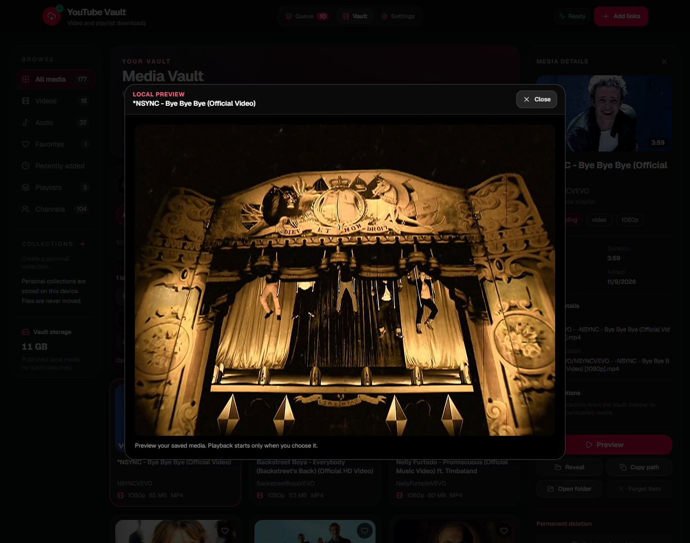

<p align="center">
  
</p>

# YouTube Vault

A local desktop app for Windows, macOS, and Linux. Save permitted YouTube videos
and playlists, manage a persistent queue, and organize your media in a searchable
Vault. The Wails desktop edition opens in its own native window and uses native
save, folder, and confirmation dialogs.

Download only content you own or have permission to save, in accordance with
YouTube's terms. DRM, private-account credentials, cookie imports, paywall bypasses,
and live-stream recording are unsupported.

## Screenshots

### Download queue

Track each selected playlist entry as an individual download, with progress,
transfer speed, and time remaining.



### Media Vault

Browse saved videos and audio, filter your collection, and select a file to view
its details, preview it, or find it on disk.



### Local preview

Play saved media inside the app without leaving your Vault.



## Get the app

Choose **AMD64** for Intel/AMD computers or **ARM64** for Windows on ARM and Apple
Silicon. Each target has both a no-install portable package and an installer:

| Platform | Portable package | Installer |
| --- | --- | --- |
| Windows 10/11 | `youtube-vault-windows-<arch>.exe` and companion `.zip` with notices | `youtube-vault-windows-<arch>-setup.exe` |
| macOS | `youtube-vault-darwin-<arch>.tar.gz`, containing `YouTube Vault.app` | `youtube-vault-darwin-<arch>.pkg` |
| Linux | `youtube-vault-linux-<arch>.tar.gz` | `youtube-vault-linux-<arch>.deb` |

The desktop packages are currently validated on this branch through
[GitHub Actions](https://github.com/ajbergh/yt-dl-go/actions/workflows/desktop.yml).
The published [v0.1.0 release](https://github.com/ajbergh/yt-dl-go/releases/tag/v0.1.0)
contains the earlier browser/server edition (`youtube-downloader-*`), not these
Wails installers. Check the asset names and release notes before downloading.
CI artifacts and release dry runs are validation builds, not a published desktop release.

- **Windows:** run the setup EXE for Start menu/desktop shortcuts and an uninstaller,
  or run the standalone portable EXE. WebView2 is required; setup provisions it
  when missing and needs internet access for that step. Distribute the companion
  notices ZIP with the portable EXE.
- **macOS:** open the PKG to install into `/Applications`, or extract the tarball
  and open `YouTube Vault.app`. Ordinary validation builds have no Developer ID
  signature or notarization. See the [signing policy](docs/RELEASES.md#native-platform-signing).
- **Linux:** on compatible Debian/Ubuntu systems, run
  `sudo apt install ./youtube-vault-linux-amd64.deb` (use `arm64` when appropriate).
  The portable tarball also needs compatible GTK3, WebKitGTK 4.1, and system
  libraries; it is not a self-contained AppImage. See [runtime requirements](docs/DESKTOP.md).

All distributables have SHA-256 sidecars. The release pipeline also produces a
combined checksum manifest and build provenance. These do not replace native OS
signing. Windows Authenticode and credentialed macOS signing verification remain
release work.

## Use YouTube Vault

1. Paste an authorized video or playlist URL and choose **View options**. Use
   **Multiple links** to inspect several links at once.
2. Choose video or audio, a maximum quality, and any available captions. For a
   playlist, select the entries you want to download.
3. Confirm your rights and add the downloads to **Queue**. Each selected playlist
   entry is an individual download task with its own progress, speed, and status.
   Pause, resume, reorder, or retry downloads as needed.
4. Open **Vault** to browse saved media in a grid or list. Search and filter by
   media type, category, or channel; use favorites and personal collections to
   organize files without moving them.
5. Select a media card to open its details. **Preview** plays the saved local
   video or audio inside the app. **Reveal**, **Copy path**, and **Open folder**
   help you find the file on disk.

The Queue badge counts visible download tasks, including individual playlist
entries. **Clear completed** hides finished tasks from Queue while keeping their
files in the Vault. Enable **System notifications** in Settings and grant permission
to receive completion or failure alerts for individual downloads.

The Vault's **Forget item** action removes the selected entry from the Vault while
keeping its file on disk. **Delete selected file** permanently removes that file;
**Delete entire download** removes every file from the source download, including
playlist files on unloaded Vault pages. Both deletion actions require confirmation.
**Forget history** in Queue keeps Vault files and entries. Desktop confirmations
use native Yes/No dialogs, with No selected by default.

Use **Settings** to choose the download folder, naming rules, and defaults.
An **Unsaved changes** indicator tracks edits; choose **Save preferences** to apply
them. Format, transfer, and naming controls are under **Advanced settings**;
version information and update checks are under **About & updates**.
Use **File → Exit** to close the desktop app and **Help → About** for build details.

Quality choices are ceilings, not upscaling requests or guarantees. **Compatibility
MP4** selects H.264/AAC; **Best quality**, **Prefer VP9**, and **Prefer AV1** may
produce WebM when appropriate. The completed file shows its actual quality and
format, and fallback notes explain changes. M4A preserves a compatible source
AAC track; MP3 conversion is built in. Captions are optional VTT/SRT sidecars and
may fail independently of the media download.

For browser-assisted adaptive HD/4K delivery, install Chrome, Chromium, or Microsoft
Edge. Browser discovery is automatic; advanced settings or `CHROME_PATH` can select
an executable. The embedded desktop WebView does not replace that dependency.
Temporary capture sessions do not import your normal browser's cookies or credentials.
YouTube delivery changes can affect availability and completion.

Closing the desktop window stops the app and its workers. The queue and Vault
persist for the next launch. No login item, background service, or tray process is installed.

## Your files and saved data

Your download folder is your Vault. Downloads default to
`~/Downloads/YouTube_Vault`, organized by channel; change this in Settings.
The app keeps one media file and plays/previews it directly from that folder.
At startup, missing files are removed from the Vault. An unavailable download
folder (for example, a disconnected drive) preserves its entries. Existing
app-only media is moved into its recorded download folder when upgrading.

Saved preferences and history live separately from the executable:

| Platform | Default application-data directory |
| --- | --- |
| Windows | `%LOCALAPPDATA%\yt-dl-go` |
| macOS | `~/Library/Application Support/yt-dl-go` |
| Linux | `$XDG_DATA_HOME/yt-dl-go`, or `~/.local/share/yt-dl-go` |

Set `DATA_DIR` before launch to choose another private location. Back up both
this data directory and your download folder with the app closed before migration
or rollback. Installers retain saved data and downloads when removed. Both
editions share this data; run one edition at a time.
Never store application data under the repository's generated `dist` directory.

For startup problems, set `DESKTOP_LOG_FILE` to a writable path before launching.
If an error reports an incompatible data schema, preserve the data and restore a
compatible backup; do not delete the database or add columns manually. Legacy
`./downloads` data can be copied with `youtube-vault --migrate-legacy-data` after
closing the app. See the [engine guide](src/server/README.md) for recovery details.

## Build from source

Install the Node version in [`.nvmrc`](.nvmrc), npm, and the Go version in
[`src/server/go.mod`](src/server/go.mod), then:

```sh
npm ci
npm run build:desktop
```

Build on the target OS. Linux and macOS also require matching native architecture;
Windows can build AMD64 and ARM64 from one host. Install NSIS 3.11 for Windows,
Xcode command-line tools for macOS, or the GTK/WebKit development libraries and
Debian packaging tools for Linux. The script installs pinned Wails tooling.

On Windows, build both architectures with:

```powershell
./scripts/build-desktop-windows.ps1
# Or only one:
./scripts/build-desktop-windows.ps1 -Architecture amd64
```

Outputs are under `dist/desktop/<os>-<arch>/`. See the
[desktop build guide](docs/DESKTOP.md) for prerequisites, explicit targets,
checksums, icons, native tests, and protected signing.

## Browser/server edition

The alternate `youtube-downloader` executable serves the same interface in your
browser. It defaults to `http://127.0.0.1:8080`; keep its process running while
using it. `--no-browser` and `--background` suppress browser opening but do not
detach the process. Stop it with Ctrl+C.

The [packaging guide](docs/PACKAGING.md) covers its scripts and platform
integration. Network/API configuration belongs to the [engine guide](src/server/README.md)
and [security policy](SECURITY.md). The desktop edition uses private per-launch
authentication and does not expose a configurable network listener.

## Development and verification

See [Contributing](CONTRIBUTING.md) for setup and checks, the
[frontend guide](src/README.md) for UI development, and the
[engine/API guide](src/server/README.md) for configuration and media behavior.
Native CI runs on all six OS/architecture targets and checks portable packages,
installer integration, native launch, removal, and saved-data preservation.

Windows manual acceptance passed for the Wails candidate on 2026-11-05, as
reported by the maintainer. macOS/Linux manual acceptance and credentialed signing
verification remain pending. See the [release checklist](docs/RELEASE_CHECKLIST.md)
for current evidence and the remaining publication gates.

## Documentation

- [Desktop builds and runtime](docs/DESKTOP.md)
- [Packaging and artifact names](docs/PACKAGING.md)
- [Release/update policy](docs/RELEASES.md) and [release checklist](docs/RELEASE_CHECKLIST.md)
- [Contributing](CONTRIBUTING.md), [security](SECURITY.md), and [changelog](CHANGELOG.md)
- [Roadmap](roadmap.md)

## License

MIT for the project; third-party components retain their licenses. Distributions
include dependency notices, license texts, LGPL decoder source, and relinking
materials. Tagged releases include the corresponding project source archive.
See [third-party notices](src/server/THIRD_PARTY_NOTICES.md) and
[LGPL relinking instructions](src/server/LGPL_RELINKING.md).
